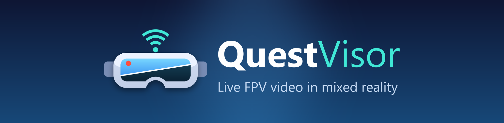

# QuestVisor

Watch the live FPV video from **DJI Goggles 3** on a big virtual screen in **Meta Quest 3** mixed reality,
with about **23 ms** added latency (PC arrival to the headset display).

> **Unofficial.** QuestVisor is an independent hobby project. It is not affiliated with, endorsed by or
> supported by DJI or Meta. "DJI", "Avata", "O4", "Meta" and "Quest" are trademarks of their owners and are
> used here only to say which hardware this works with.



Version 0.1.0 (first public release). See [CHANGELOG.md](CHANGELOG.md).

> **Tested with the video link in 16:9 only.** QuestVisor has been built and tested with the goggles' video link
> in 16:9 mode. **4:3 is currently untested** (the only 4:3 stream seen so far was the O4 Pro's race mode,
> 1440×1080, in one session on 2026-11-19). A 4:3 setting may send a stream size the app has no fake keyframe
> for, and the video then does not start until the goggles send a keyframe.

---

## How it works

```
DJI Goggles 3 ──USB──> Windows PC ──Wi-Fi / LAN──> Meta Quest 3
 (192.168.60.2:9100)    QuestVisor-Relay.exe        QuestVisor app
                        TCP 9201 (video)            hardware H.265/H.264 decoder,
                        UDP 9200 (clock)            screen in passthrough,
                        UDP 9202 (discovery)        replay buffer
```

The goggles share their live view over USB as a small network (RNDIS). The relay on the PC picks the
stream up and passes it on to the headset unchanged, the instant it arrives, adding only a timestamp so the app
can measure the real latency. The app decodes it with the Quest's hardware decoder and shows it on a screen you
can move, resize, curve or lock to your head, in passthrough. The app finds the relay on its own, and keeps
the last few minutes of video on the headset so you can watch a crash again.

## Requirements

* **Meta Quest 3** (Horizon OS, developer mode on, to install an APK from outside the Meta store).
* **DJI Goggles 3** with a linked air unit. Tested with the **DJI Avata 2** and the **DJI O4 Pro** air unit.
* **Windows PC with a USB port** for the goggles' USB-C cable. Windows installs the goggles' network adapter
  ("Remote NDIS based Internet Sharing Device") on its own.
* **QuestVisor-Relay.exe** running on that PC (from the release, or built from `relay/`).
* PC and Quest on the **same local network**. The stream is 13–63 Mbit/s, so use 5 GHz or 6 GHz Wi-Fi for
  the Quest, ideally with the PC on Ethernet to the router.

## Install

### 1. The app on the Quest

Either **SideQuest** (install the APK or the listing with SideQuest, headset connected by USB), or **adb**:

```powershell
adb install -r -g QuestVisor-0.1.0.apk
```

The app then shows up in the Quest library under **Unknown Sources**.

> **0.1.0 is signed with a debug key.** A later version signed with the project's release key cannot be
> installed over it: uninstall QuestVisor first (`adb uninstall com.xerx.questvisor`, or in SideQuest), which
> also resets its saved settings, including the PC address.

### 2. Connect the goggles to the PC

1. Power on the goggles and the drone / air unit, and wait until the goggles show the live view.
2. Plug the goggles' USB-C port into the PC.
3. Windows adds a network adapter ("Remote NDIS based Internet Sharing Device") and gives the PC the address
   `192.168.60.1`; the goggles are `192.168.60.2`. The relay finds the goggles at either address by itself.
4. **If the adapter gets no `192.168.60.x` address** (Windows shows "Unidentified network" and a `169.254.x.x`
   address, and the relay says so), set it by hand: Settings > Network & internet > Advanced network settings >
   the goggles' adapter > Edit IP settings > Manual, IPv4 address `192.168.60.1`, subnet mask `255.255.255.0`,
   no gateway. Or in an **administrator** PowerShell (the relay prints the adapter's name, for example
   `Ethernet 4`):

   ```powershell
   netsh interface ipv4 set address name="Ethernet 4" static 192.168.60.1 255.255.255.0
   ```

   If the goggles are still not found, use `192.168.60.2` for the PC instead.

### 3. Run the relay

Double-click **QuestVisor-Relay.exe**. No options are needed: it finds the goggles on their USB network
(`192.168.60.2` or `192.168.60.1`, port 9100), shows their live video in a window on the PC, and waits for the
headset on TCP **9201** (video) and UDP **9200** (latency clock). Once a second it announces itself on the local
network (UDP broadcast to port **9202**), so the app finds it without an address. It prints its status:

```
QuestVisor Relay 0.1.0
listening on 0.0.0.0:9201 (TCP) for the Quest
this PC: <your PC's IP address> (QuestVisor finds the relay by itself; enter this address only if it does not)
video window: on (--no-window turns it off)
clock: UDP 0.0.0.0:9200
discovery: announcing on UDP 9202 from <your PC's IP address>
waiting for goggles at 192.168.60.2:9100 (DJI Goggles 3 on USB, powered on) ...
goggles connected at 192.168.60.2:9100
video window: H.265 stream, d3d11va decoding
Quest connected: <the Quest's IP address>:50122
in 33.85 Mbit/s, 100.0 fps, codec h265, params yes | PC window backlog 0.1 ms resyncs 0, <Quest IP> backlog 0.1 ms resyncs 0
```

Close the console window (or Ctrl+C) to stop the relay.

**Video window.** The PC shows the same video the headset gets, with size, codec, frame rate and bitrate in the
title bar. It is resizable; **F** or **F11** toggles full screen, **Esc** leaves full screen, **Q** or closing it
hides it (the relay keeps running). It runs in its own process and decodes on the graphics card (Direct3D 11),
and if it ever falls behind it is skipped ahead on its own, so it never slows down the stream to the headset.
Like the headset, it starts on a neutral grey picture when it joins a running stream; still areas keep a grey
wash until the goggles send a keyframe (arming, a mode switch), while everything that moves is repaired within
a second or so.

Options (`QuestVisor-Relay.exe --help`):

| Option | Default | Meaning |
|---|---|---|
| `--goggles HOST[:PORT]` | found automatically | where the goggles serve the video; by default the relay tries `192.168.60.2` and `192.168.60.1` (whichever is not the PC), port `9100` |
| `--no-window` | off | do not show the video on the PC |
| `--listen PORT` | `9201` | TCP port the Quest connects to |
| `--clock-port PORT` | `9200` | UDP clock for the latency measurement, `0` = off (the app's clock port is fixed at 9200) |
| `--discovery-port PORT` | `9202` | UDP port the relay announces itself on, `0` = off (the app listens on 9202) |
| `--no-sei` | off | do not insert the timestamp SEIs |
| `--max-backlog-ms`, `--max-backlog-kb` | `150`, `1024` | a headset that falls this far behind is skipped ahead to the next frame |
| `--stats SECONDS` | `5` | interval of the status line, `0` = off |
| `--version` | | print the version |

Without the .exe: `python relay\simple_forwarder.py` (Python 3.9+) takes the same options. The relay itself
needs only the standard library; the video window needs `pip install av pygame-ce` and is left out (with a
note) when they are missing.

### 4. Windows Firewall

The first time the relay runs, Windows asks whether to allow it on networks. Allow it on **Private networks**
(and make sure your home network is set to Private, not Public). If you missed the prompt, or the Quest cannot
connect, add the rules yourself in an **administrator** PowerShell:

```powershell
New-NetFirewallRule -DisplayName "QuestVisor Relay TCP 9201" -Direction Inbound -Protocol TCP -LocalPort 9201 -Action Allow -Profile Private
New-NetFirewallRule -DisplayName "QuestVisor Relay UDP 9200" -Direction Inbound -Protocol UDP -LocalPort 9200 -Action Allow -Profile Private
```

TCP 9201 carries the video. UDP 9200 is only for the latency figure in the stats; without it the video still
works and the stats show `clock none`. The discovery announcements are outgoing broadcasts and need no rule.

### 5. Start QuestVisor

Start QuestVisor from the library (Unknown Sources). It listens for the relay's announcement and connects by
itself, usually within a second; the settings panel shows `Relay found: <PC name> (<address>)`. If the PC gets
a new address, the app follows it. With no announcement (for example a router that blocks broadcasts between
Wi-Fi and Ethernet), it uses the last address that worked, or you can set one once with adb:

```powershell
adb shell am start -n com.xerx.questvisor/.PlayerActivity --es host <PC-IP> --ei port 9201 --ez autoconnect true
```

`<PC-IP>` is the address the relay prints (IPv4; host names are not supported).

Other launch options: `--ez stats true` (stats column), `--ez headlock true`, `--ef fit 100|155`,
`--ef screenwidth <m>`, `--ef curve 0..1`, `--ez occlusion true`; all of them are saved like the settings below.

### 6. Watch

Put the headset on. The screen appears in front of you in passthrough. Recenter (hold the Meta button) to
bring it back in front of you at any time.

## In-app controls

| Control | What it does |
|---|---|
| **Move** | Grab the screen anywhere (controller grip or hand pinch) and move it. While holding it, turn your wrist left/right to turn the screen, up/down to tilt it. |
| **Scale** | Grab with both hands (or both controllers) and pull apart / push together. The size is kept. |
| **Settings cog** | Just outside the screen's lower-right corner. It shows while you point at the screen, while the settings are open, and whenever no video is coming in. Opens or closes the settings panel under the screen. |
| **Connect / Disconnect** | Start or stop the stream (`Host`, `Port`, `Status` and the relay discovery line are shown above the buttons). The app connects by itself when it finds the relay; after **Disconnect** it waits until you press **Connect**. |
| **Keep: off / 1 / 2 / 5 / 10 min** | How much of the received video the replay buffer keeps (default 5 min). **Off** deletes the recording. |
| **−30 s / −10 s** | Replay from 30 or 10 seconds back (from live, or from the current replay position). |
| **Pause / Play** | Pause and resume the replay. |
| **Live** | Back to the live video. |
| **Size − / Size +** | Screen width in steps of ×1.25. |
| **Curve** | 0 % (flat) up to 100 % (wrapped around your head), in steps of 25 %. |
| **100°** / **155° lens** | Presets that size and curve the screen so the picture's diagonal spans 100° (all of it in view) or 155° (the camera lens, natural angles). |
| **head lock** | The screen follows your head and stays straight ahead, like the goggles. Limited to 100° while on. |
| **occlusion** | Your hands and real objects in front of the screen hide it (Meta Depth API). Asks for the spatial-data permission the first time. Probably adds about one display frame of latency; edges are hard. |
| **Show stats** | A column with bitrate, frame counters, decode and display latency, dropped frames, decoder. |
| **Network / Goggles USB** | Intake path. Use **Network**. Goggles USB (goggles plugged straight into the Quest) is experimental and does not work yet. |
| **keyflag / recsei** | Decoder hints for experiments; leave off. |
| **Reset defaults** | Resets host and port to the built-in defaults (empty host; the app then relies on discovery). |

The screen follows the stream's aspect ratio (16:9, or 4:3 in O4 Pro race mode), and the display refresh rate
follows the frame rate (30 fps → 90 Hz, 60 fps → 120 Hz, 100 fps → 100 Hz), so frames are paced evenly. All
settings are saved.

## Replay buffer

The app records the video it receives, exactly as it arrives (every frame, no re-encoding), so you can watch
the last minutes again, for example right after a crash. Press **−30 s** or **−10 s** in the settings.

* **Length:** set with **Keep** (off, 1, 2, 5 or 10 minutes; default 5). Older video is deleted as new video
  comes in, so the space used stays fixed.
* **Space:** about 8 MB/s at 63 Mbit/s (1080p60), so 5 minutes take about 2.4 GB at most; 100 fps race mode
  (34 Mbit/s) about 1.3 GB.
* **While replaying,** recording pauses, so the footage you are watching is not overwritten. **Live** resumes
  live video and recording.
* **Why not record fewer frames?** Every frame the goggles send is built on the previous one (no frame can be
  skipped), so a 30 fps copy of a 60 or 100 fps stream would not play back.
* **Seeking:** replay starts at the nearest 2-second point before the chosen time. As when joining a live stream,
  the first moment can show a black or blocky picture until the image builds up.
* The recording is stored in the app's own folder on the headset and is removed when the app is uninstalled. It
  survives an app restart, so a crash can still be watched after the app was closed (until you start flying again
  for longer than the buffer length). Saving a clip to a video file is not supported yet.

## Latency

Measured on a Quest 3 over Wi-Fi with the relay on the PC (2026-11-19/20), averaged over one-second readings:

| Stream | Decode (first byte → decoded) | PC arrival → on screen |
|---|---|---|
| Avata 2, H.265 1832×1032 30 fps | 12.7 ms | **23.2 ms** (median 22.5, max 35.1) |
| Avata 2 armed, H.265 1920×1080 60 fps | 14.5 ms | **~23 ms** |
| O4 Pro normal, H.264 1920×1080 60 fps | 6.8 ms codec time | **~28 ms** |
| O4 Pro race, H.265 1440×1080 100 fps | 5.0 ms codec time | **~23 ms** (21.5–22.2 ms at 100 Hz) |

"PC arrival → on screen" starts when the frame reaches the PC and ends at the decoder's frame-rendered callback,
so it covers the relay, Wi-Fi, decoding and display, but not the goggles' own radio link and encoder, and not the
compositor's last step to the lenses. Dropped frames: 0 in all runs. With **occlusion** on, the figure does not
include the extra frame the app's render pass probably adds.

## Supported stream modes

The goggles switch format on their own (arming, D-Log M, race mode). The app and the relay follow codec and
resolution changes mid-stream: the decoder restarts within ~35–45 ms.

Built and tested with the video link in **16:9**; **4:3 is currently untested** (see the note at the top).

| Source | Codec | Resolution | Frame rate | Bitrate |
|---|---|---|---|---|
| Avata 2, disarmed | H.265 | 1832×1032 | 30 fps | ~13–21 Mbit/s |
| Avata 2, armed / flying | H.265 | 1920×1080 | 60 fps | ~63 Mbit/s |
| Avata 2, D-Log M | H.264 High | 1832×1032 | 30 fps | ~13–15 Mbit/s |
| O4 Pro, normal | H.264 High | 1920×1080 | 60 fps | ~63 Mbit/s |
| O4 Pro, race mode | H.265 | 1440×1080 | 100 fps | ~34 Mbit/s |

The goggles send hardly any keyframes (often only one, at a mode switch). So that a headset can join a running
stream, the app carries a black "fake" keyframe for each of these sizes and inserts it when it joins; the relay
only passes the stream on and replays the latest parameter sets to each new headset. A size not in that list
will not start mid-stream.

No audio: only video is relayed.

## Troubleshooting

| Symptom | Cause / fix |
|---|---|
| Relay keeps printing `waiting for goggles` / `timed out` | Goggles not on USB, not powered on, or no `192.168.60.x` adapter yet (`ping 192.168.60.2`). Try another cable or port; a cable that only charges will not work. The relay says which: `no goggles network card on this PC`, or that the card has no `192.168.60.x` address (set it by hand, step 2.4). |
| Relay prints `goggles connected` but `0.0 fps` | The goggles are not sending video: check that the goggles show the live view (drone / air unit on and linked). Re-plug the goggles. |
| `connection refused` / the relay never connects, while another tool is running | The goggles serve **one client at a time**. Close any other relay or tool that is connected to the goggles. (One relay can serve several headsets.) |
| `cannot listen on TCP port 9201` | Another relay is already running. Close it, or use `--listen` with another port (and `--ei port` on the Quest). |
| Settings say `Looking for the relay on the network...` | The relay is not running, or its broadcasts do not reach the Quest (different networks, guest Wi-Fi, or a router that does not pass broadcasts between Ethernet and Wi-Fi). Set the address once with adb (step 5). |
| App status stays `Connecting`, relay never shows `Quest connected` | Firewall blocking TCP 9201, the network set to Public, or Quest and PC on different networks / guest Wi-Fi with client isolation. |
| `No relay found: start QuestVisor-Relay on the PC` when pressing Connect | No relay announcement heard and no address saved yet; see step 5. |
| Black screen, nothing happens, no logs | The headset is asleep: the proximity sensor sees no face, and the app only gets its video surface while the headset is worn. Wear it, or, for testing on a desk, `adb shell am broadcast -a com.oculus.vrpowermanager.prox_close` (undo with `adb shell am broadcast -a com.oculus.vrpowermanager.automation_disable`). |
| Picture stutters or the relay prints `fell behind - resync` | Wi-Fi too slow for the stream (63 Mbit/s at 1080p60). Use 5/6 GHz, get closer to the router, put the PC on Ethernet. |
| Stats show `clock none` | UDP 9200 blocked by the firewall; only the latency figure is missing, the video works. |
| After joining, still areas show blocky remnants | Expected with the O4 Pro right after joining or a mode switch: the stream has no keyframes, and still areas are only repaired when something moves through them. |
| Screen not visible | Hold the Meta button to recenter. |

## Building the relay from source

The relay is `relay/simple_forwarder.py` (Python 3.9+, standard library only) plus the video window,
`relay/relay_preview.py` (PyAV and pygame-ce) with its fake keyframes in `relay/fakeidr/`. To build the .exe:

```powershell
powershell -ExecutionPolicy Bypass -File relay\build_relay_exe.ps1
# -> build\relay\dist\QuestVisor-Relay.exe  (one file, ~50 MB, no Python needed to run it)
```

The script creates its own virtual environment with PyInstaller, PyAV and pygame-ce in the work folder
(`-WorkDir` to change it, `-Python` to pick the interpreter).

## Building the Quest app from source

The app is the Gradle project in `questvisor/` (Kotlin + Meta Spatial SDK 0.15, native MediaCodec player in
`app/src/main/cpp/`). Needs JDK 17+ (21 tested), the Android SDK with `platforms;android-34`, `build-tools;34.0.0`,
`ndk;26.1.10909125` and `cmake;3.22.1`; Gradle comes with the wrapper.

```powershell
cd questvisor
$env:ANDROID_HOME = "$env:LOCALAPPDATA\Android\Sdk"     # or sdk.dir=... in local.properties
.\gradlew.bat :app:assembleDebug                         # -> app\build\outputs\apk\debug\app-debug.apk
adb install -r -g app\build\outputs\apk\debug\app-debug.apk
```

A release build (`:app:assembleRelease`) needs signing data; see `questvisor/keystore.properties.example`. App
reference (controls, launch options, logs, stats, source layout): [questvisor/README.md](questvisor/README.md)
and [questvisor/TECHNICAL.md](questvisor/TECHNICAL.md). `tools/` holds the generators for the fake keyframes in
`questvisor/app/src/main/assets/fakeidr/` (needed to support a new stream size).

## Repository layout

```
questvisor/   the Quest app (Gradle project)
relay/        the PC relay and its video window, build script for QuestVisor-Relay.exe
tools/        fake-keyframe generators and H.264/H.265 parameter-set helpers
store-assets/ icon, banners, SideQuest listing
```

## License

QuestVisor is free software under the **GNU General Public License version 3** ([LICENSE](LICENSE)), with an
additional permission to combine the app with the Meta Spatial SDK, which keeps its own terms
([LICENSE-EXCEPTION.md](LICENSE-EXCEPTION.md)). Anyone may use, study, change and share it; versions that are
shared must stay under the same license, with their source. Third-party components:
[THIRD_PARTY_NOTICES.md](THIRD_PARTY_NOTICES.md).
